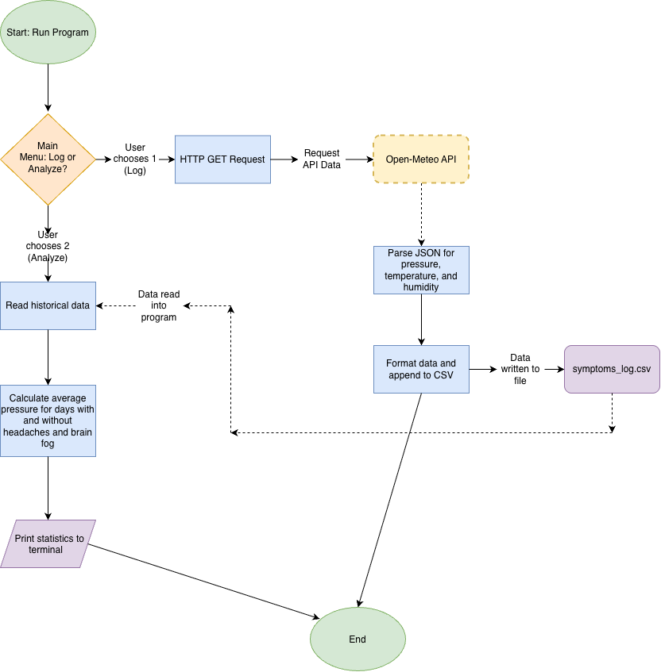

# environmental-symptom-tracker

A Java CLI tool that tracks daily medical symptoms and automatically correlates them with environmental factors using live weather APIs.

## The Problem
I experience unusual morning brain fog and localized headaches that neurology appointments haven't explained. Tracking these symptoms manually feels overly subjective and creates unhelpful variability. Because I live in a dorm on a bunk bed, I cannot rely on sleep-tracking apps. I need a tool that can automatically track objective environmental factors, like barometric pressure and humidity changes, and correlate them with my symptoms to help me and my neurologist find actionable patterns.

## How It Works
This is a Java command-line tool where the user can log their daily symptoms (Yes/No) each morning. The program automatically pings the Open-Meteo API to pull the current barometric pressure, temperature, and humidity, saving the combined data to a local '.csv' file. The user can also run an "Analyze" command to calculate correlations between their currently logged historical symptoms and specific weather or pressure patterns.

 

## Tech Stack
- **Language:** Java
- **Libraries/External Tools:**
  -java.net.http.HttpClient for sending GET requests to the API.
  -java.lang.IO and java.io.FileWriter for terminal input and CSV file writing.
  -Gson or org.json library to parse the JSON data returned by the API.
- **Data Storage:** A local `symptoms_log.csv` file.
- **Data Source:** The free Open-Meteo API for live barometric pressure and weather data.

## Setup & Usage
*(will fill later)*

## Roadmap
- [ ] Add a feature to edit or delete previous entries if a mistake was made.
- [ ] Implement a terminal-based ASCII chart to visually plot pressure trends over the last 7 days.
- [ ] Allow the user to track multiple different symptoms (e.g., sleep quality, caffeine intake alongside headaches).
